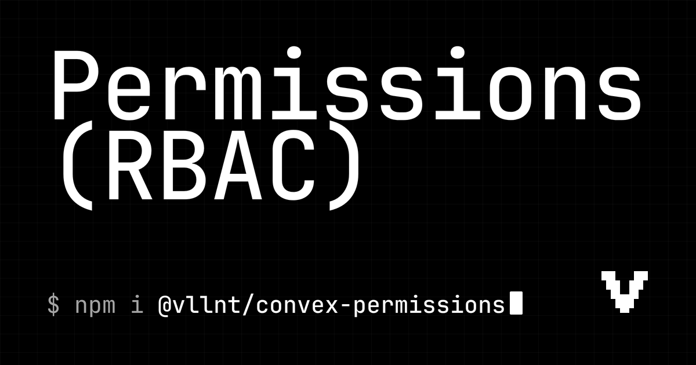

# @vllnt/convex-permissions



Role-based access control (RBAC) component for Convex: runtime-editable roles, wildcard grants, scoped multi-tenant checks, and a typed TypeScript client.

## For coding agents

Docs matching the installed version ship in `node_modules/@vllnt/convex-permissions/`: `README.md`, `docs/API.md`, `CHANGELOG.md`, `llms.txt`, and the TypeScript source in `src/`.
Read [docs/API.md](./docs/API.md) for signatures and [Errors and fixes](#errors-and-fixes) for every thrown error.

## When to use

- Use it when roles and their grants must change at runtime, from a mutation, without a redeploy.
- Use it when a subject holds different roles per tenant, org, or workspace (an opaque `scopeRef`).
- Use it when you need default-deny checks from Convex queries, mutations, actions, and HTTP actions, typed by your own role and action unions.
- Do not use it when access depends on relationships between resources (ReBAC, such as "can edit every doc in a folder I own"): model the relationships in your own tables and indexes.
- Do not use it when access depends on attributes of the resource or request (ABAC, such as owner, status, or time): check those fields in your own query or mutation code.
- Do not use it when roles are fixed at deploy time: a typed `Record<Role, Action[]>` helper in your own code needs no tables and no component calls.

## Install

```bash
npm install @vllnt/convex-permissions
```

These docs describe version 0.2.0. If `npm view @vllnt/convex-permissions version` prints an older version, install `@vllnt/convex-permissions@canary` or read the README inside your installed package.
Peer dependency: `convex@^1.45.0`.

## Quick start

```ts
// convex/convex.config.ts: mount the component.
import { defineApp } from "convex/server";
import permissions from "@vllnt/convex-permissions/convex.config";
const app = defineApp();
app.use(permissions);
export default app;
```

```ts
// convex/docs.ts: provision a role from an internal mutation, check it from a query.
import { Permissions } from "@vllnt/convex-permissions";
import { v } from "convex/values";
import { components } from "./_generated/api";
import { internalMutation, query } from "./_generated/server";

type Role = "admin" | "editor" | "viewer";
type Action = "doc.read" | "doc.edit" | "doc.delete";

const permissions = new Permissions<Role, Action>(components.permissions);

// Internal: run it from the dashboard, the CLI, or your own admin-only mutation.
export const makeEditor = internalMutation({
  args: { userId: v.string() },
  returns: v.null(),
  handler: async (ctx, { userId }) => {
    await permissions.defineRole(ctx, {
      name: "editor",
      grants: ["doc.read", "doc.edit"],
    });
    await permissions.assign(ctx, { subjectRef: userId, role: "editor" });
    return null;
  },
});

export const canEdit = query({
  args: {},
  returns: v.boolean(),
  handler: async (ctx) => {
    const identity = await ctx.auth.getUserIdentity();
    if (identity === null) return false;
    return permissions.check(ctx, {
      subjectRef: identity.subject,
      action: "doc.edit",
    });
  },
});
```

Assign and check with the same host-owned subject ID. `subjectRef` must match `^[A-Za-z0-9_.:-]{1,128}$`; if your auth provider's `subject` has other characters, map it to your own user ID first.

## API

Full signatures, defaults, and return shapes: [docs/API.md](./docs/API.md).

| Export                                            | Kind                        | What it does                                                               | Reference                                                  |
| ------------------------------------------------- | --------------------------- | -------------------------------------------------------------------------- | ---------------------------------------------------------- |
| `new Permissions<TRole, TAction>(component)`      | class                       | Typed client; pass `components.permissions`                                | [Permissions](./docs/API.md#permissions)                   |
| `defineRole(ctx, { name, grants, description? })` | method, needs `runMutation` | Create or replace a role (upsert by name); resolves `null`                 | [defineRole](./docs/API.md#definerole)                     |
| `removeRole(ctx, name)`                           | method, needs `runMutation` | Delete a role definition, keep its assignments; resolves `true` if deleted | [removeRole](./docs/API.md#removerole)                     |
| `assign(ctx, { subjectRef, role, scopeRef? })`    | method, needs `runMutation` | Assign a role globally or in a scope; resolves `true` if created           | [assign](./docs/API.md#assign)                             |
| `revoke(ctx, { subjectRef, role, scopeRef? })`    | method, needs `runMutation` | Delete the exact assignment; resolves `true` if deleted                    | [revoke](./docs/API.md#revoke)                             |
| `check(ctx, { subjectRef, action, scopeRef? })`   | method, needs `runQuery`    | Resolves `true` if allowed, `false` otherwise (default-deny)               | [check](./docs/API.md#check)                               |
| `require(ctx, { subjectRef, action, scopeRef? })` | method, needs `runQuery`    | Resolves if allowed; throws `ConvexError` with `code: "FORBIDDEN"` if not  | [require](./docs/API.md#require)                           |
| `rolesFor(ctx, { subjectRef, scopeRef? })`        | method, needs `runQuery`    | Sorted role names that apply in the scope                                  | [rolesFor](./docs/API.md#rolesfor)                         |
| `permissionsFor(ctx, { subjectRef, scopeRef? })`  | method, needs `runQuery`    | Sorted distinct grant strings that apply in the scope                      | [permissionsFor](./docs/API.md#permissionsfor)             |
| `listRoles(ctx)`                                  | method, needs `runQuery`    | Every role definition as `RoleDoc[]`                                       | [listRoles](./docs/API.md#listroles)                       |
| `PermissionsComponent`                            | type                        | Shape of the mounted component reference the constructor accepts           | [PermissionsComponent](./docs/API.md#permissionscomponent) |
| `PermissionDenied`                                | type                        | `data` of the `ConvexError` thrown by `require`                            | [PermissionDenied](./docs/API.md#permissiondenied)         |
| `RoleDoc`                                         | type                        | A stored role, as returned by `listRoles`                                  | [RoleDoc](./docs/API.md#roledoc)                           |
| `@vllnt/convex-permissions/convex.config`         | default export              | Component definition for `app.use(...)`                                    | [convex.config](./docs/API.md#convexconfig-default-export) |
| `register(t, name = "permissions")` from `/test`  | function                    | Mount the component on a `convex-test` instance                            | [register](./docs/API.md#register)                         |
| `ComponentApi` from `/_generated/component`       | type                        | Generated type of `components.permissions`                                 | [ComponentApi](./docs/API.md#componentapi)                 |

## Common tasks

### Check a role in one tenant (scoped, multi-tenant)

A scoped check sees global assignments plus that scope's; an unscoped check sees only global assignments.

```ts
import { Permissions } from "@vllnt/convex-permissions";
import { components } from "./_generated/api";
import type { MutationCtx, QueryCtx } from "./_generated/server";

const permissions = new Permissions(components.permissions);

export async function addOrgEditor(
  ctx: MutationCtx,
  userId: string,
  orgId: string,
) {
  await permissions.assign(ctx, {
    subjectRef: userId,
    role: "editor",
    scopeRef: orgId,
  });
}

export async function canEditInOrg(
  ctx: QueryCtx,
  userId: string,
  orgId: string,
) {
  return permissions.check(ctx, {
    subjectRef: userId,
    action: "doc.edit",
    scopeRef: orgId,
  });
}
```

### Grant a group of actions with a wildcard, or everything with a super-role

`"doc.*"` matches every action that starts with `doc.`; `"*"` matches every non-empty action.

```ts
import { Permissions } from "@vllnt/convex-permissions";
import { components } from "./_generated/api";
import type { MutationCtx } from "./_generated/server";

const permissions = new Permissions(components.permissions);

export async function seedRoles(ctx: MutationCtx) {
  await permissions.defineRole(ctx, {
    name: "doc-admin",
    grants: ["doc.*"],
    description: "Every doc action",
  });
  await permissions.defineRole(ctx, {
    name: "superadmin",
    grants: ["*"],
    description: "Every action",
  });
}
```

### Return HTTP 403 when require denies access

`require` throws a `ConvexError`; read `error.data as PermissionDenied` (the interface does not satisfy `ConvexError`'s `Value` type argument).

```ts
import { Permissions, type PermissionDenied } from "@vllnt/convex-permissions";
import { httpRouter } from "convex/server";
import { ConvexError } from "convex/values";
import { components } from "./_generated/api";
import { httpAction } from "./_generated/server";

const permissions = new Permissions(components.permissions);
const http = httpRouter();

http.route({
  path: "/docs/delete",
  method: "POST",
  handler: httpAction(async (ctx) => {
    const identity = await ctx.auth.getUserIdentity();
    if (identity === null) return new Response(null, { status: 401 });
    try {
      await permissions.require(ctx, {
        subjectRef: identity.subject,
        action: "doc.delete",
      });
    } catch (error) {
      if (
        error instanceof ConvexError &&
        (error.data as PermissionDenied).code === "FORBIDDEN"
      ) {
        return new Response(JSON.stringify(error.data), {
          status: 403,
          headers: { "content-type": "application/json" },
        });
      }
      throw error;
    }
    return new Response(null, { status: 204 });
  }),
});

export default http;
```

### Revoke holders before removing a role

`removeRole` keeps assignments, and they grant again if the name is reused. The component has no query that lists a role's holders, so pass the ones you assigned.

```ts
import { Permissions } from "@vllnt/convex-permissions";
import { components } from "./_generated/api";
import type { MutationCtx } from "./_generated/server";

const permissions = new Permissions(components.permissions);

export async function retireRole(
  ctx: MutationCtx,
  role: string,
  holders: { subjectRef: string; scopeRef?: string }[],
) {
  for (const holder of holders) {
    await permissions.revoke(ctx, { ...holder, role });
  }
  return permissions.removeRole(ctx, role);
}
```

### List roles and permissions

`permissionsFor` returns stored grant strings, wildcards included, not expanded actions.

```ts
import { Permissions } from "@vllnt/convex-permissions";
import { components } from "./_generated/api";
import type { QueryCtx } from "./_generated/server";

const permissions = new Permissions(components.permissions);

export async function accessSummary(
  ctx: QueryCtx,
  userId: string,
  orgId: string,
) {
  const roles = await permissions.rolesFor(ctx, {
    subjectRef: userId,
    scopeRef: orgId,
  });
  const grants = await permissions.permissionsFor(ctx, {
    subjectRef: userId,
    scopeRef: orgId,
  });
  const definitions = await permissions.listRoles(ctx);
  return { roles, grants, roleCount: definitions.length };
}
```

### Test your app with register

Needs `convex-test` and Vitest (Vite's `import.meta.glob`).

```ts
/// <reference types="vite/client" />
import { Permissions } from "@vllnt/convex-permissions";
import { register } from "@vllnt/convex-permissions/test";
import { convexTest } from "convex-test";
import { expect, test } from "vitest";
import { components } from "./_generated/api";
import schema from "./schema";

const modules = import.meta.glob("./**/*.ts");
const permissions = new Permissions(components.permissions);

test("a scoped editor can edit only in their org", async () => {
  const t = convexTest(schema, modules);
  register(t);
  const result = await t.mutation(async (ctx) => {
    await permissions.defineRole(ctx, { name: "editor", grants: ["doc.*"] });
    await permissions.assign(ctx, {
      subjectRef: "user_1",
      role: "editor",
      scopeRef: "org_1",
    });
    return {
      inOrg: await permissions.check(ctx, {
        subjectRef: "user_1",
        action: "doc.edit",
        scopeRef: "org_1",
      }),
      global: await permissions.check(ctx, {
        subjectRef: "user_1",
        action: "doc.edit",
      }),
    };
  });
  expect(result).toEqual({ inOrg: true, global: false });
});
```

## Errors and fixes

| Error                                                                          | Thrown by    | Cause                                                                           | Fix                                                                          |
| ------------------------------------------------------------------------------ | ------------ | ------------------------------------------------------------------------------- | ---------------------------------------------------------------------------- |
| `ConvexError`, `data` = `{ code: "FORBIDDEN", subjectRef, action, scopeRef? }` | `require`    | No role of the subject has a grant that matches the action                      | Catch it and map it to a 403, or assign a role whose grants match the action |
| `role name must match /^[A-Za-z0-9_.:-]{1,128}$/`                              | `defineRole` | `name` has a character outside `A-Za-z0-9_.:-`, is empty, or is longer than 128 | Use 1 to 128 letters, digits, `_`, `.`, `:`, or `-`                          |
| `grant must be a non-empty string`                                             | `defineRole` | A grant is `""`                                                                 | Remove empty grants                                                          |
| `subjectRef must match /^[A-Za-z0-9_.:-]{1,128}$/`                             | `assign`     | `subjectRef` is outside the token pattern                                       | Map the identity to an ID of 1 to 128 letters, digits, `_`, `.`, `:`, or `-` |
| `role must match /^[A-Za-z0-9_.:-]{1,128}$/`                                   | `assign`     | `role` is outside the token pattern                                             | Use the same valid name you passed to `defineRole`                           |
| `scopeRef must match /^[A-Za-z0-9_.:-]{1,128}$/`                               | `assign`     | `scopeRef` is given and is outside the pattern, including `""`                  | Omit `scopeRef` for a global assignment, or pass a valid scope ID            |

The five validation errors are plain `Error`s, not `ConvexError`s. They reach the host function as a failed `runMutation` call; under `convex-test` the error message contains the text above. Match on it only in host code: Convex redacts errors that are not `ConvexError` to "Server Error" for clients of a production deployment ([Convex error handling](https://docs.convex.dev/functions/error-handling)). Arguments of the wrong type fail Convex argument validation first. See [Error codes](./docs/API.md#error-codes).

## Limits and gotchas

- Token pattern: role names (`defineRole`, `assign`), `subjectRef`, and `scopeRef` on `assign` must match `^[A-Za-z0-9_.:-]{1,128}$`, at most 128 characters.
- Grants only need to be non-empty; actions are never validated.
- Default-deny: no assignment, no defined role, or no matching grant means `check` resolves `false` and `require` throws.
- An empty action (`""`) is always denied, even with a `"*"` grant.
- Wildcards: only `"*"` and a trailing `.*` widen; `"doc.*"` does not match `"doc"`, and any other `*` is literal.
- An unscoped check sees only global assignments; a scoped assignment never applies to it.
- `assign` does not require the role to exist; the assignment grants nothing until the role is defined, but `rolesFor` lists it.
- `removeRole` keeps the role's assignments; defining the same name again re-activates them. No query lists a role's holders.
- `revoke` never validates its arguments and deletes only the exact (subject, role, scope) row; `removeRole` does not validate the name.
- `check`, `rolesFor`, and `permissionsFor` never validate refs and never throw for malformed ones. They match stored rows exactly, so a ref that `assign` rejects finds nothing (`false` or `[]`) unless 0.1.0 stored a row with it.
- `defineRole` replaces grants and description; omitting `description` on an update removes it. An unchanged role (same grants in the same order, same description) writes nothing.
- `listRoles` returns every role in one query, with no pagination.
- The component cannot read `ctx.auth` ([Convex docs](https://docs.convex.dev/components/authoring): "Within a component, `ctx.auth` is not available"). Authenticate in the host and pass `subjectRef`.
- Typing: `defineRole` grants accept any string, so grant typos are not type errors; `rolesFor` and `permissionsFor` return `string[]`.

## Compatibility

- Peer dependency `convex@^1.45.0`; `engines.node` `>=20`; ESM package (`"type": "module"`).
- Convex Cloud and self-hosted: the component uses only standard component APIs (`defineComponent`, `ctx.db`, `runQuery`, `runMutation`) and no deployment-specific API. This repo's tests run on `convex-test`, not on a live deployment.
- `/test` ships as TypeScript source and uses `import.meta.glob`: it needs `convex-test` and Vitest or another Vite-based runner.

## Testing

```bash
pnpm test
pnpm test:coverage
pnpm test:package
```

Tests run the component with `convex-test` on the `@edge-runtime/vm` environment, with no mocks; `pnpm test:coverage` enforces 100% coverage. `pnpm test:package` packs the tarball, type-checks a strict consumer, and type-checks every `ts` example in this README and `docs/API.md` against it.

## Security

- The host authenticates callers, maps them to an opaque `subjectRef`, and chooses the `scopeRef`.
- Call `defineRole`, `removeRole`, `assign`, and `revoke` only from internal functions or mutations your own admin policy protects; the component does not check who calls them.
- Host code cannot read the component tables directly, only through the component's functions. Deployment admins can still read and edit them in the Convex dashboard.
- Report vulnerabilities as described in the [security policy](https://github.com/vllnt/convex-permissions/blob/main/SECURITY.md).

## Related packages

No other package is used with this one in code: its only runtime peer is `convex`, and its tests and example mount no other component.

## Contributing

See the [contributing guide](https://github.com/vllnt/convex-permissions/blob/main/CONTRIBUTING.md) for setup, checks, and releases.

## Links

- Docs and changelog: [oss.vllnt.com/packages/convex-permissions](https://oss.vllnt.com/packages/convex-permissions) · [release feed](https://oss.vllnt.com/packages/convex-permissions/rss.xml)
- All @vllnt packages: [oss.vllnt.com](https://oss.vllnt.com) · [search packages and docs on index.vllnt.com](https://index.vllnt.com)
- Source and issues: [GitHub](https://github.com/vllnt/convex-permissions) · [issues](https://github.com/vllnt/convex-permissions/issues) · [npm](https://www.npmjs.com/package/@vllnt/convex-permissions)
- Questions and updates: [Discord](https://bntvllnt.com/discord) · [X @bntvllnt](https://x.com/bntvllnt)
- Company and author: [vllnt.com](https://vllnt.com) · [bntvllnt.com](https://bntvllnt.com) · [GitHub @bntvllnt](https://github.com/bntvllnt) · [LinkedIn](https://linkedin.com/in/bntvllnt)
- Sponsor: [GitHub Sponsors](https://github.com/sponsors/bntvllnt)

## License

MIT. See [LICENSE](./LICENSE).

---

Part of [vllnt open source](https://oss.vllnt.com) · [Package page](https://oss.vllnt.com/packages/convex-permissions) · [vllnt.com](https://vllnt.com) · Built by [bntvllnt](https://bntvllnt.com)
